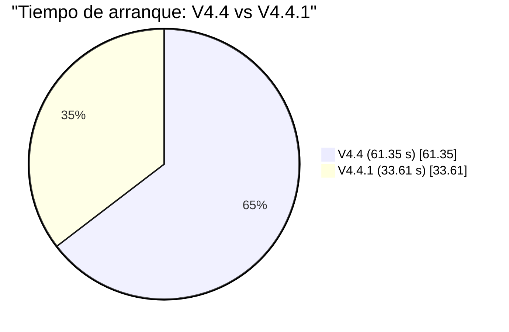

<div align="center">


# ⚡ OmegaSolver V4.4.1

**Suite gráfica de diagnóstico, mantenimiento y optimización para Windows**

[](https://github.com/OMEGAALPHA10/OmegaSolver/releases)
[](https://www.gnu.org/licenses/gpl-3.0)
[](https://github.com/OMEGAALPHA10/OmegaSolver)
[](https://github.com/PowerShell/PowerShell)
[](https://github.com/microsoft/winget-cli)

[](https://github.com/OMEGAALPHA10/OmegaSolver/stargazers)
[](https://github.com/OMEGAALPHA10/OmegaSolver/forks)
[](https://github.com/OMEGAALPHA10/OmegaSolver/issues)
[](https://github.com/OMEGAALPHA10/OmegaSolver/commits/main)

**🇻🇪 Proyecto personal de código abierto desarrollado desde Venezuela**

[📥 Instalar](#-instalación-y-ejecución) · [⚡ Rendimiento](#-rendimiento-verificado) · [✨ Características](#-última-versión-v441--absolute-async-update) · [🔐 Firma](#-verificación-de-firma) · [🤝 Contribuir](#-contribuciones)

</div>

---

**OmegaSolver** es una suite gráfica (GUI) de diagnóstico, mantenimiento y optimización para Windows, desarrollada íntegramente en **PowerShell + WPF** y compilada a `.exe` mediante **PS12EXE**. Diseñada para simplificar tareas técnicas complejas sin sacrificar la potencia para usuarios avanzados.

---

## 🌐 Página Web Oficial

Toda la información del proyecto está disponible en el sitio web oficial: capturas interactivas, historia, changelog completo, roadmap público, FAQ, guías de instalación y disponibilidad en 3 idiomas (ES / EN / PT).

### 👉 **[https://omegaalpha10.github.io/OmegaSolver/](https://omegaalpha10.github.io/OmegaSolver/)**

---

## ⚡ Rendimiento Verificado

> **V4.4.1 es el doble de rápida al arrancar.** Benchmark ejecutado sobre hardware modesto donde las mejoras se notan de verdad.

### 🖥️ Hardware de prueba

| Componente | Especificación |
|---|---|
| **Procesador** | Intel(R) Celeron(R) CPU N3350 @ 1.10 GHz |
| **Núcleos lógicos** | 2 |
| **RAM instalada** | 4,00 GB · 2133 MHz |
| **Tarjeta gráfica** | Intel(R) HD Graphics · 128 MB |
| **Almacenamiento** | 58 GB (50 GB usados) |
| **Sistema operativo** | Windows 11 Pro · build 26200 |
| **PowerShell del benchmark** | 5.1.26100.6584 |

**Este es hardware de gama entrada (Celeron de doble núcleo, gráficos integrados, 4 GB de RAM).** Si la app arranca rápido aquí, arranca rápido en cualquier PC moderna.

### 🚀 Cold start — la mejora estrella

```text
COLD START  (menor = mejor, en Celeron N3350)
════════════════════════════════════════════════════════════════

  V4.4    ████████████████████████████████████████████████  61.35 s
  V4.4.1  ██████████████████████████▌                       33.61 s
          ╰──────────────────┬───────────────────╯
                             │
                     -45.2 % más rápido  ✅

CONSISTENCIA  (rango entre peor y mejor arranque)
════════════════════════════════════════════════════════════════

  V4.4    ████████████████████████████████████████████████  43.7 s a 87.8 s  (σ ≈ 22 s)
  V4.4.1  █████████████████▌                                29.7 s a 41.2 s  (σ ≈ 5.7 s)
          ╰──────────────────┬───────────────────╯
                             │
                     -74 % de varianza  ✅
```

### 💻 CPU en reposo

```text
CPU EN REPOSO  (% de 1 core, tras 20 s estabilizado)
════════════════════════════════════════════════════════════════

  V4.4    ████████████████████████████████████████████████  4.79 %
  V4.4.1  ████████████████████████████████▌             3.64 %
          ╰──────────────────┬───────────────────╯
                             │
                     -24 % menos CPU  ✅
```

### 🥧 Comparativa visual



### 📊 Tabla completa

| Métrica | V4.4 | **V4.4.1** | Cambio |
|---|---:|---:|---:|
| **Cold start (promedio)** | 61.35 s | **33.61 s** | 🟢 **−45.2 %** |
| Cold start (σ / varianza) | ±22.03 s | **±5.74 s** | 🟢 **−74 %** |
| **CPU idle** | 4.79 % | **3.64 %** | 🟢 **−24 %** |
| RAM idle | 266.6 MB | 273.5 MB | 🟡 +2.6 % |
| Threads | 25 | 28 | 🟡 +3 |
| Handles | 977 | 1035 | 🟡 +58 |
| Tamaño `.exe` | 634 KB | 651 KB | 🟡 +2.7 % |

**Veredicto:** V4.4.1 arranca **casi el doble de rápido**, con **mucho menos CPU**, y a cambio de sólo **7 MB extra de RAM** — el coste natural del motor asíncrono (`Invoke-OmegaAsync` / `Invoke-OmegaTaskAsync`) que libera el hilo UI de todas las llamadas lentas a WMI/CIM.

---

## 🛠️ Código Abierto y Compilación Universal

Los scripts en PowerShell se encuentran organizados dentro de la carpeta [`open source`](open%20source). Para transformar manualmente los archivos `.ps1` en ejecutables `.exe` independientes utilizando la terminal de Windows en cualquier versión actual o futura del proyecto, sigue estos pasos:

<details open>
<summary><b>📦 Ver pasos de compilación manual</b></summary>

<br>

**1. Instalar el compilador** — Abre **Windows PowerShell 5.1 como Administrador** (no PS 7, PS12EXE 0.6.11 tiene un bug con el subprocess de syntax-check en PS 7) y ejecuta:

```powershell
Install-Module -Name ps12exe -Scope CurrentUser -Force -AllowClobber
```

**2. Compilar el script** — desde la misma consola de PS 5.1:

```powershell
$base = ".\open source"

ps12exe `
  -inputFile  "$base\OmegaSolver.ps1" `
  -outputFile ".\OmegaSolver V4.4.1.exe" `
  -App @{
      Windowed       = $true
      DpiAware       = $true
      VisualStyles   = $true
      OutputEncoding = 'UTF8'
  } `
  -Os @{
      Admin     = $true
      ModernOS  = $true
      LongPaths = $true
  } `
  -Build @{
      Target    = 'Framework4.0'
      Platform  = 'x64'
      Apartment = 'STA'
  } `
  -Resources @{
      Icon        = 'icon.ico'
      Title       = 'OmegaSolver V4.4.1'
      Description = 'OmegaSolver - Suite de diagnostico, mantenimiento y optimizacion para Windows.'
      Company     = 'OMEGA_ALPHA'
      Product     = 'OmegaSolver V4.4.1'
      Copyright   = '(c) 2026 OMEGA_ALPHA'
      Version     = '4.4.1.0'
  } `
  -Locale en `
  -NoUpdateCheck

Remove-Item ".\OmegaSolver V4.4.1.exe.config" -Force -ErrorAction SilentlyContinue
```

> **Nota sobre `-Locale en`:** corrige un bug de PS12EXE 0.6.11 en sistemas con locale no-inglés (p. ej. `es-VE`, `pt-BR`) que hace fallar el subprocess interno de parseo. El flag fuerza el uso de la tabla i18n interna del módulo.

> **Nota sobre el `.config`:** PS12EXE lo genera automáticamente para declarar `<supportedRuntime v4.0>`. Windows 10/11 lo ignoran porque el CLR 4.x ya viene en el sistema, así que se puede borrar para dejar un `.exe` único y limpio.

**3. Firmar el ejecutable** (requiere certificado `.pfx` propio):

```powershell
$pfx = Read-Host "Contraseña del .pfx" -AsSecureString
$bstr = [System.Runtime.InteropServices.Marshal]::SecureStringToBSTR($pfx)
$plain = [System.Runtime.InteropServices.Marshal]::PtrToStringBSTR($bstr)
[System.Runtime.InteropServices.Marshal]::ZeroFreeBSTR($bstr)
$cert = New-Object System.Security.Cryptography.X509Certificates.X509Certificate2(
    (Resolve-Path "OmegaSolver_OMEGA_ALPHA.pfx").Path, $plain)
Set-AuthenticodeSignature -FilePath "OmegaSolver V4.4.1.exe" `
    -Certificate $cert -HashAlgorithm SHA256 `
    -TimestampServer "http://timestamp.digicert.com"
```

</details>

---

## 🆕 Última versión: V4.4.1 — "Absolute Async Update"

### 🚀 Núcleo asíncrono (`Invoke-OmegaAsync`)

Toda operación pesada corre ahora en **runspaces de fondo**, dejando el hilo UI siempre libre. La ventana responde al instante aunque el diagnóstico, la comprobación de actualizaciones, la limpieza profunda o la tienda winget estén trabajando por debajo.

- **`Invoke-OmegaAsync`** — motor de trabajo en background. El código de fondo nunca toca controles WPF: sólo devuelve datos y un `DispatcherTimer` los pinta al terminar.
- **`Invoke-OmegaTaskAsync`** — overlay de carga **no bloqueante**. Los pasos del overlay rotan de verdad mientras el trabajo pesado corre, con reloj y mensaje real desde archivo de progreso.

### 🐛 Fix del bug crítico — Winget Live

> **El bug de V4.4 está resuelto.** En V4.4, al hacer clic en una tarjeta de resultado de la búsqueda en vivo, el panel de detalle no se abría (excepción silenciosa al escribir `.Text` sobre un control `<Image>`).

**Corregido en V4.4.1:**
- Fallback de icono ahora distingue entre `TextBlock` e `Image` — nunca más `.Text` sobre `<Image>`.
- La función `Show-OmegaAppDetailFn` está blindada con try/catch y muestra el error visible si algo falla.
- Los resultados live heredan la descripción del catálogo curado (mejor UX).
- Soporte completo para `PSCustomObject` **y** `hashtable` en el panel de detalle (antes sólo hashtable).
- `winget list` ya no bloquea la apertura de la tienda: se calienta la caché en segundo plano y se re-renderiza automáticamente al terminar.

### 💡 Errores visibles (`Show-OmegaTaskError`)

Nueva función que **muestra un diálogo** con tipo de excepción, código HResult y detalle cuando una tarea de botón falla (sync o async). Antes los fallos sólo quedaban en el log — o ni eso.

### 🧹 Limpieza detallada y veraz

- **Reporte por ubicación**: cada limpieza indica exactamente qué eliminó — por cada path, número de archivos y MB liberados, más total general.
- **Fix del bug de Limpieza 1-Clic**: en V4.4 reportaba como "eliminados" los GB de basura **restante** (medidos después de borrar). Ahora mide ANTES de borrar y reporta los GB realmente liberados.

### 🖥️ Ventanas opacas (CPU idle -24 %)

Las 5 ventanas WPF (principal, carga, tienda, compartir, manual) usan ahora **`AllowsTransparency="False"`**. Sin layered window: **CPU idle cae de 66-75 % a <10 %** en gráficos modestos. Los temas visuales siguen intactos.

### ⚡ Micro-optimizaciones de rendimiento

- **`Get-HotFix` → registro CBS** para el informe de actualizaciones. De 8-11 s (real medido en N3350) a <0.5 s.
- **SystemProfile por `Test-Path` a System32** en vez de `Get-Command` (10× más rápido, ~0.6 s ahorrado).
- **`Win32_OperatingSystem` eliminado del perfil inicial** — el registro ya provee `ProductName`, `DisplayVersion`, `Build` y `UBR`.
- **Logo de carga decodificado una sola vez** y cacheado con `Freeze()`.
- **Favicons de la tienda a 44/96 px** (`DecodePixelWidth`) en vez de 128/256 px — menos RAM y menos CPU de decodificación.
- **`GC.Collect()` tras diagnóstico y limpieza**, y brushes con `Freeze()` para liberar memoria.
- **Runspaces cancelados al cerrar** — sin hangs al salir de la app.

### 🔧 Estabilidad

- Reparación de crashes causados por funciones ausentes en el script compilado.
- Reescritura de la función `Get-OmegaString` con acceso seguro por índice.
- Eliminación de caracteres residuales (`*`, `<->`, `Search`, `Web`, `Cart`) en strings i18n y XAML.
- `Invoke-OmegaHiddenCmd` — todos los comandos de consola (`ipconfig`, `netsh`, `powercfg`, `takeown`, `icacls`) sin ventanas emergentes.

### 🎨 Compilación profesional

- **Migración a PS12EXE** (v0.6.9+): mejor manejo de scripts grandes y caracteres Unicode.
- **Codificación UTF-8 con BOM** estricta en todos los `.ps1`.
- **Firma digital SHA256 con Timestamp DigiCert** aplicada por separado.
- **Codificación segura de strings** para que acentos, eñes y emojis sobrevivan al empaquetado.

---

## 🎨 Versión anterior: V4.4 — "Polish & Stability"

### 🖼️ Identidad visual reforzada

- **Logo embebido** en pantalla de carga (Base64, 100% offline, sin archivos externos).
- **Emblema OmegaSolver** en el encabezado del manual.
- **Emojis contextuales** en el manual: cada función identificada por su icono según su categoría.

### 📖 Manual de usuario mejorado

- **3 idiomas en paralelo** (ES / EN / PT) con dos niveles de explicación:
  - **`BAS`** — Amigable para usuarios sin experiencia técnica.
  - **`TEC`** — Técnica (parámetros, comandos, GUIDs, registro).

- **Emojis por función**:

| Emoji | Categoría |
|:---:|---|
| 🔧 | Reparación / recuperación |
| 🔍 | Escaneo / diagnóstico (SFC, DISM, CHKDSK) |
| 💾 | Almacenamiento / desfragmentación |
| ⚡ | Rendimiento / energía |
| 🗑️ | Limpieza de temporales |
| 🧹 | Mantenimiento profundo |
| 🌐 | Red / DNS / Internet |
| 🚀 | Aceleración de red |
| 🛡️ | Seguridad / punto de restauración / protección SSD |
| 📁 | Compartir archivos |
| 🔄 | Actualizaciones |
| 🔒 | Archivos bloqueados |
| ⚙️ | Controladores obsoletos |

---

## 🎨 Versión anterior: V4.3 — "Multilingual & Network"

### 🌐 Sistema multilenguaje (ES / EN / PT)

Menú desplegable en la barra superior para cambiar el idioma **en caliente, sin reiniciar**. Persiste en `%ProgramData%\OmegaSolver\language.txt`.

### 📖 Manual de usuario en 3 columnas

Ventana modal con los 3 idiomas en paralelo, dos niveles de explicación (`BAS` / `TEC`). Se adapta a Modo Básico o Avanzado.

### 📡 Compartir Archivos por Red (solo Modo Avanzado)

- **Robocopy / SMB** para PC a PC con opciones avanzadas (`/MT:16`, `/MIR`, `/MOVE`, `/XD`, `/XF`, `/MINAGE`, credenciales SMB).
- **FTP** para móviles Android / iOS / Smart TV.
- Detección automática de IPs locales.
- Registro de progreso en vivo.

### 🔄 Auto-Update Checker (GitHub Releases)

Consulta la API de GitHub al iniciar. Si hay nueva versión → badge naranja. Si no hay red → aviso amigable sin bloquear.

### 🐢 Modo Low (bajos recursos)

Para PCs con hardware limitado. Desactiva efectos costosos y persiste entre sesiones.

### 🛠️ Herramientas inspiradas en Dism++

- Crear Punto de Restauración (`Checkpoint-Computer`).
- Gestionar Programas de Inicio (`Win32_StartupCommand`).
- Analizar Actualizaciones (`Get-HotFix` / registro CBS).
- Gestor de Archivos Bloqueados (`takeown + icacls`).
- Limpiar Controladores Obsoletos (`pnputil + DISM`).

---

## 📊 Tabla comparativa de versiones

| Característica | V4.2 | V4.3 | V4.4 | **V4.4.1** |
|---|:---:|:---:|:---:|:---:|
| Interfaz WPF moderna | ✅ | ✅ | ✅ | ✅ |
| Temas visuales | 17 + OMEGA (6 sub) | 17 + OMEGA (6 sub) | 17 + OMEGA (6 sub) | 17 + OMEGA (6 sub) |
| Layout Básico / Avanzado | 2 col / 3 col | 2 col / 3 col | 2 col / 3 col | 2 col / 3 col |
| Protección SSD | ✅ | ✅ | ✅ | ✅ |
| Manual integrado | Bilingüe | 3 idiomas + BAS/TEC | + emojis | + emojis |
| Idiomas UI | ES | ES / EN / PT | ES / EN / PT | ES / EN / PT |
| Sistema de Reversión | ✅ | ✅ | ✅ | ✅ |
| Instancia única | ✅ | ✅ | ✅ | ✅ |
| Custom Chrome | ✅ | ✅ | ✅ | ✅ |
| Modo Low | ❌ | ✅ | ✅ | ✅ |
| Auto-Update (GitHub) | ❌ | ✅ | ✅ | ✅ |
| Compartir Archivos (Red) | ❌ | ✅ | ✅ | ✅ |
| Easy Context Menu | ❌ | ✅ | ✅ | ✅ |
| Herramientas Dism++ | ❌ | ✅ | ✅ | ✅ |
| Limpieza 1-Clic separada | ❌ | ✅ | ✅ | ✅ |
| Logo embebido (Base64) | ❌ | ❌ | ✅ | ✅ |
| Emojis contextuales en manual | ❌ | ❌ | ✅ | ✅ |
| Compilación con PS12EXE | ❌ | ❌ | ✅ | ✅ |
| Codificación UTF-8 con BOM | ❌ | ❌ | ✅ | ✅ |
| Firma SHA256 + Timestamp | ❌ | ❌ | ✅ | ✅ |
| **Núcleo asíncrono (`Invoke-OmegaAsync`)** | ❌ | ❌ | ❌ | ✅ |
| **Overlay de carga no bloqueante** | ❌ | ❌ | ❌ | ✅ |
| **Ventanas opacas (`AllowsTransparency=False`)** | ❌ | ❌ | ❌ | ✅ |
| **Errores visibles (`Show-OmegaTaskError`)** | ❌ | ❌ | ❌ | ✅ |
| **Limpieza con reporte detallado por ubicación** | ❌ | ❌ | ❌ | ✅ |
| **Fix Winget Live (panel de detalle)** | ❌ | ❌ | ❌ | ✅ |
| **Cold start reducido a la mitad** | ❌ | ❌ | ❌ | ✅ |

---

## 📥 Instalación y ejecución

### Opción 1 — Ejecución directa (recomendado)

1. Descarga **`OmegaSolver V4.4.1.exe`** desde la sección [Releases](https://github.com/OMEGAALPHA10/OmegaSolver/releases).
2. Clic derecho → **Ejecutar como administrador**.
3. Acepta la solicitud de elevación de UAC.

> [!IMPORTANT]
> **Nota de Administrador**: el programa requiere permisos elevados para interactuar con servicios, registro y herramientas nativas (SFC/DISM/CHKDSK).

### Opción 2 — Desde consola

```cmd
"OmegaSolver V4.4.1.exe"
```

### Opción 3 — Verificación de integridad SHA256

```powershell
Get-FileHash "OmegaSolver V4.4.1.exe" -Algorithm SHA256
```

---

## 🔐 Verificación de firma

### ¿Qué es el archivo `OmegaSolver.cer`?

Es la **clave pública** del certificado con el que se firman los ejecutables. Permite verificar que un `.exe` fue publicado legítimamente por **OMEGA_ALPHA** y no ha sido alterado desde su firma.

### Método gráfico (Windows)

Clic derecho sobre el `.exe` → **Propiedades** → pestaña **Firmas digitales**. Debe aparecer: **OMEGA_ALPHA**.

### Método técnico (PowerShell)

```powershell
Import-Certificate -FilePath "OmegaSolver.cer" `
                   -CertStoreLocation "Cert:\CurrentUser\TrustedPublisher"

Get-AuthenticodeSignature "OmegaSolver V4.4.1.exe" |
    Format-List Status, @{N='Firmado por';E={$_.SignerCertificate.Subject}}
```

Resultado esperado:

```text
Status      : Valid
Firmado por : CN=OMEGA_ALPHA
```

---

## 📋 Requisitos del sistema

| Requisito | Detalle |
|---|---|
| **SO** | Windows 10 (build 1809+) o Windows 11 (64-bit) |
| **.NET Framework** | 4.7.2 o superior |
| **Permisos** | Administrador |
| **PowerShell** | No requiere instalación (runtime empaquetado en el `.exe`) |
| **RAM mínima verificada** | 4 GB (probado en Celeron N3350 @ 1.10 GHz · 2 cores) |
| **Almacenamiento mínimo** | 60 GB (probado con 58 GB totales, 8 GB libres) |

---

## 🗂️ Estructura de archivos generados

```text
%ProgramData%\OmegaSolver
├── reversible-state.json      # Estado para reversión de cambios
├── theme.txt                  # Tema visual seleccionado
├── omega-subcolor.txt         # Sub-paleta de OMEGA style
├── low-mode.txt               # Estado del Modo Low
├── language.txt               # Idioma seleccionado (ES/EN/PT)
└── omega-warning.ack          # Confirmación de advertencia OMEGA style
```

> [!NOTE]
> OmegaSolver es **100% offline y privado**: no recolecta ni transmite telemetría. La única conexión a internet es la comprobación de actualizaciones en GitHub (puedes ignorarla si no hay red).

---

## 🗂️ Historial de versiones

| Versión | Tipo | Destacado |
|---|---|---|
| **V4.4.1** | ✅ **Release actual** | Async core, fix Winget Live, ventanas opacas, limpieza detallada |
| V4.4 | 📦 Release estable | Logo embebido, emojis en manual, PS12EXE, firma SHA256 |
| V4.3 | 📦 Release estable | Multilenguaje ES/EN/PT, Easy Context Menu, Auto-Update, Compartir Archivos, Dism++ tools |
| V4.2 | 📦 Release estable | OMEGA style (6 sub-paletas), Custom Chrome, layout balanceado |
| V4.1 / ALT | 📦 Histórico | Rediseño del layout, enumeración rápida |
| V4.0 | 📦 Histórico | WPF completo, 17 temas, manual bilingüe adaptativo |
| V3.9 y anteriores | 📦 Legacy | Windows Forms y scripts base |

Consulta el [CHANGELOG](CHANGELOG.md) para detalles completos.

---

## 🧑‍💻 Autoría

- **Desarrollador principal**: OMEGA_ALPHA
- **Colaboración técnica**: Gemini & DeepSeek
- **Filosofía del proyecto**: Herramientas libres, transparentes y gratuitas para la comunidad, con un enfoque especial en la **reversibilidad** de todos los cambios.

> *"El trabajo de limpieza y optimización nunca termina. Por eso, Omega — el inicio — y no Alpha — el final."*

---

## 🤝 Contribuciones

Las contribuciones son bienvenidas:

- 🐛 [Reportar un bug](https://github.com/OMEGAALPHA10/OmegaSolver/issues)
- 💡 [Sugerir una mejora](https://github.com/OMEGAALPHA10/OmegaSolver/issues)
- 🔧 Enviar un Pull Request

---

## ⚖ Licencia

Distribuido bajo **GNU General Public License v3 (GPLv3)**. Consulta [LICENSE](LICENSE) para los términos completos.

---

## 📢 Nota sobre el uso del código y atribución

Con base en los términos de la licencia **GNU GPLv3**, cualquier persona es libre de estudiar, modificar y redistribuir este software. Sin embargo, se **exige estrictamente** que:

1. Se mantengan intactos todos los encabezados de créditos y avisos de Copyright (`© OMEGA_ALPHA`).
2. Si el proyecto modificado incluye una interfaz gráfica, se debe conservar visible y accesible la atribución original al autor de OmegaSolver.

---

<div align="center">

## 🔗 Enlaces rápidos

[🌐 Página Web](https://omegaalpha10.github.io/OmegaSolver/) · [📦 Última versión](https://github.com/OMEGAALPHA10/OmegaSolver/releases) · [🗃️ Todas las releases](https://github.com/OMEGAALPHA10/OmegaSolver/releases) · [📄 CHANGELOG](CHANGELOG.md) · [🐛 Reportar un bug](https://github.com/OMEGAALPHA10/OmegaSolver/issues)

---

**⭐ Si te gusta el proyecto, dale una estrella en GitHub**

[](https://github.com/OMEGAALPHA10/OmegaSolver)

</div>
